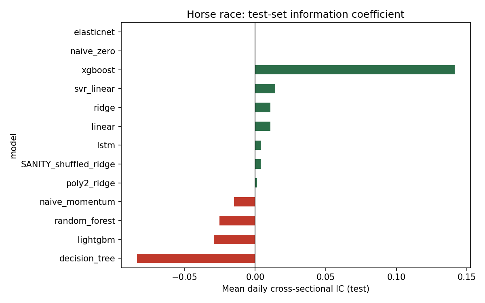
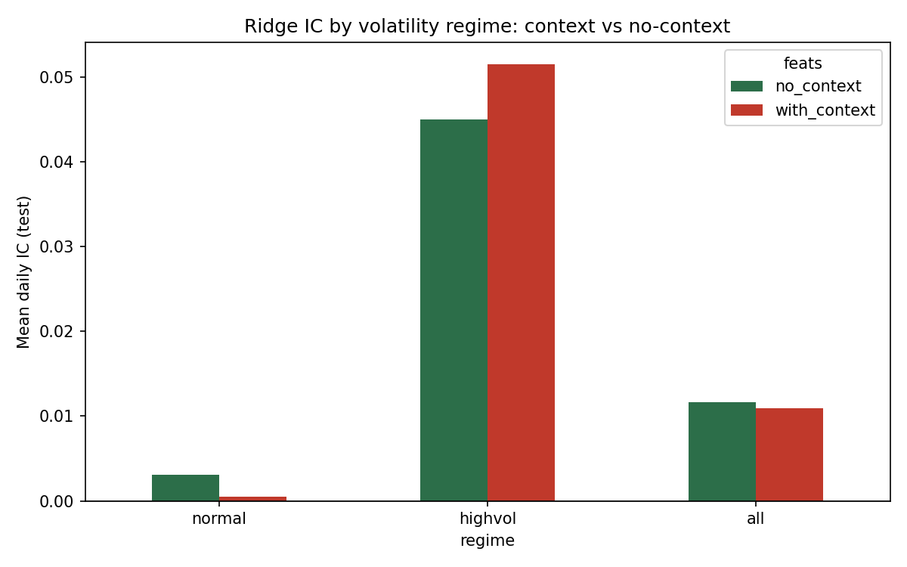
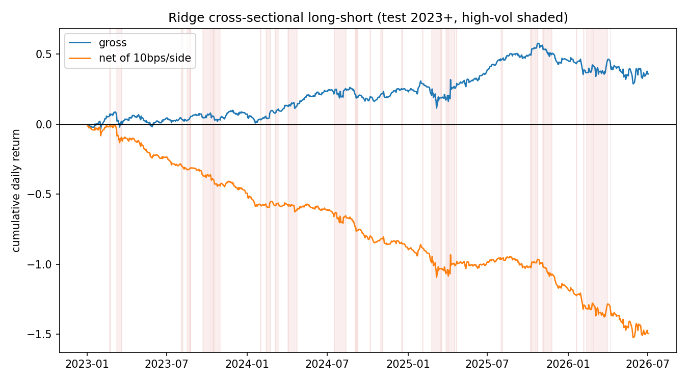

# LSTM vs classical models for daily US stock returns

Can a neural network that reads price history (an LSTM) predict tomorrow's stock returns better than
simpler models? On 21 years of daily data for about 500 large US stocks, no model predicted
returns better than guessing zero, and the one pattern that did show up appeared on stressful days
and was eaten by trading costs.

Nicholas Hong · NTU Undergraduate Research Opportunities Programme (UROP)

**Paper:** [`paper/LSTM_forecasting_IEEE.pdf`](paper/LSTM_forecasting_IEEE.pdf) · **Executed notebook:** [`notebooks/LSTM_stock_forecasting.ipynb`](notebooks/LSTM_stock_forecasting.ipynb)

## What I built

- A data pipeline that turns a Bloomberg Terminal export (or a free yfinance mirror with the same
  layout) into one long table of daily prices and volumes, plus market context series.
- A horse race of twelve forecasters on the same features and the same chronological split:
  naive zero, naive momentum, linear, ridge, elastic net, polynomial ridge, decision tree, random
  forest, XGBoost, LightGBM, linear SVR, and a PyTorch LSTM trained on all stocks at once.
- A cross-sectional test that ranks stocks against each other each day, splits days into calm and
  stressed, and trades the ranking with costs.

## Data

518 tickers: 501 S&P 500 stocks and 17 country and index ETFs, March 2005 to July 2026, exported
from a Bloomberg Terminal with `mod_BBG_UROP_Export.bas` (not in this repo). The workbook holds 520;
FDXF and HONA have 29 and 16 days of history, too few for the 50-day features, and drop out of the
panel. A yfinance mirror
(`src/pull_yfinance.py`) produces the same columns for development and matches the Bloomberg
closes (`results/parity_report.csv`, median absolute difference ≈ 0). Context series: VIX, MOVE,
DXY, the US Treasury curve and commodities. The Bloomberg panel is licensed and is not in this
repository.

## Method

- Split. Train on data up to 2021, validate on 2022, test on 2023 onward. Features use
  information up to the close of day t; the target is the return from day t to day t+1. Scalers
  are fitted on the training years only.
- Level forecasts. Each model predicts each stock's next-day return. They are scored by RMSE
  (the typical size of the forecast error), MAE, directional accuracy, and rank IC.
  Rank IC: how well a model orders stocks from best to worst on a given day, from −1 to +1,
  averaged over days.
- Cross-sectional forecasts. The target becomes each stock's next-day return minus the
  average stock's. A stressed day is one where the VIX is more than one standard deviation above
  its 63-day average (a VIX z-score above 1). The code uses that one threshold throughout.
- Trading test. Each day, buy the top tenth of stocks by forecast and sell the bottom tenth
  (a decile long-short). Results are given as a Sharpe ratio, the average return divided by its
  volatility, per year, before and after a cost of 10 basis points (0.10%) on each side of every
  trade.
- Check on the evaluation code. A ridge model trained on shuffled targets is run every time,
  and its |IC| must stay below 0.02. This checks that the scoring code does not create IC on its
  own. It cannot detect look-ahead in the features.

## Main result

**No model, the LSTM included, predicts next-day returns better than a forecast of zero.** On the
test set (2023 onward, 466,426 stock-days) the largest improvement in RMSE over zero is 0.16%
(XGBoost 0.020379 against 0.020411). Rank IC of the level forecasts:

| Model | Dir. acc. | IC | t |
|---|---|---|---|
| SVR (linear) | 0.490 | 0.014 | 2.42 |
| Ridge / Linear | 0.491 | 0.011 | 1.86 |
| LSTM (compact 32×1, early-stopped) | 0.480 | 0.004 | 0.76 |
| Shuffled-target ridge (harness check) | 0.498 | 0.004 | 0.67 |
| XGBoost (not comparable, see below) | 0.497 | 0.141 | 1.83 |
| LightGBM (not comparable, see below) | 0.496 | −0.029 | −0.69 |

The t column is a t-statistic: the average IC divided by its standard error, so values above
about 2 are unlikely to come from chance alone. The two boosted-tree rows are not comparable with
the others. Both models stop after a few boosting rounds and give almost every stock the same
prediction, and the IC is only defined on days when predictions differ across stocks. LightGBM's
figure rests on 7 of the 915 test days (`results/regime_results.csv`); XGBoost's t of 1.83 on an
IC of 0.141 implies at most 168. Ridge uses 901 days.



**Ranked against each other, stocks become a little predictable, but only on stressed days.** LightGBM's
mean daily rank IC is 0.044 (t = 3.2) on stressed days against 0.005 (t = 0.9) on calm days, and its
decile long-short earns a gross Sharpe of 2.09 on the stressed days (`results/xs_regime_results.csv`):

| Model | Regime | IC | t | L/S Sharpe gross | L/S Sharpe net (10 bp/side) | Turnover |
|---|---|---|---|---|---|---|
| LightGBM | high-vol (183 d) | **0.044** | **3.17** | **2.09** | −0.88 | 2.7 |
| LightGBM | normal (732 d) | 0.005 | 0.88 | −0.24 | −4.89 | 2.6 |
| Ridge | high-vol | 0.032 | 1.87 | 0.96 | −0.69 | 2.1 |
| Ridge | all | 0.015 | 2.76 | 0.48 | −1.99 | 2.0 |

Turnover is the share of the portfolio traded each day. The stressed-day result is one of six
regime-by-model cells, tested with plain t-statistics and no adjustment for multiple comparisons.





## What didn't work

- Trading costs remove the edge. The net Sharpe is negative in every configuration at daily
  rebalancing.
- Trading less often removes it too. At a weekly rebalance (`results/xs_weekly_results.csv`)
  the ridge IC is 0.0007; the weekly tree run produced no usable predictions.
- Standard risk factors leave no significant alpha. A four-factor regression of the daily long-short
  (`results/risk_adjusted_results.csv`) leaves an insignificant alpha (t = 1.35 all days, 0.10
  high-vol). `src/risk_adjust.py` computes and prints these figures; no script writes the csv.
- The LSTM barely trained. `results/horse_race_results.csv` is the canonical run: the full
  518-ticker Bloomberg panel, 466,426 test stock-days (465,904 for the LSTM, which needs 30 prior
  rows per ticker). Its LSTM row comes from `run_all.py --quick`, the compact configuration
  `LSTM_CFG_QUICK`: 1 layer, hidden size 32, stopped after 3 epochs on patience 2
  (`results/lstm_training_curve.csv`). The best epoch was the first (validation loss 1.397, then
  1.569 and 1.673), so the reported model is one pass of training. The configured dropout of 0.1
  has no effect, because PyTorch applies dropout only between stacked layers and this model has
  one.
- The larger LSTM was never scored. A 2×64 run reached a lower validation loss than the
  compact one (1.2557 against 1.3970), so the compact model is not shown to be the stronger of the
  two. Its test metrics were never saved, so no result is claimed for it; rerunning it on the
  canonical panel is an open item. It does not change the level-prediction conclusion: the LSTM
  loses to the zero forecast on RMSE on both panels and under both configurations (0.021138
  against 0.020411 canonical; 0.020142 against 0.019589 on the development panel).

| Artefact | Script | Configuration | Panel | Status |
|---|---|---|---|---|
| `results/horse_race_results.csv` | `run_all.py --quick` | 1×32, patience 2 | full, 465,904 test obs | **canonical** |
| `results/ckpt/*.json` | `run_zoo_ckpt.py` / `run_lstm_ckpt.py` | 1×32, patience 2 | earlier, smaller panel: 269,831 test obs (269,309 LSTM) | superseded development run, see `results/ckpt/README.md` |
| `results/lstm_full_training_curve.csv` | `run_lstm_full.py` | 2×64, dropout 0.2, patience 5 (`C.LSTM_CFG`) | earlier panel | loss curve only; test metrics were never saved |

- The row counts depend on the data extract. A rerun on 16 November 2026 from a fresh extract of the same
  Bloomberg workbook gave 465,811 test stock-days (465,289 for the LSTM). One ticker, FISV, has a
  constant volume series in that extract, which drops its 615 test rows. The tables here are from
  the saved July run.

## How to run

```
pip install -r requirements.txt
python run_all.py --source bloomberg --quick   # needs the Bloomberg CSVs in data/raw/bloomberg/; use --source yfinance for the free mirror
python run_xs_regime.py                        # the cross-sectional stress test
```

`run_xs_weekly.py` (weekly rebalance) and `run_regime.py` (level IC by regime) give the other
tables. `--quick` selects the compact LSTM that the canonical results use; every other model still
runs in full. Without it `run_all.py` trains the 2×64 LSTM and overwrites
`results/horse_race_results.csv`. `--skip-pull` skips the download and, for Bloomberg, the CSV
parsing, so use it only once `panel_ohlcv.parquet` exists. `run_lstm_ckpt.py` and
`run_zoo_ckpt.py` are resumable versions whose metrics go to `results/ckpt/*.json` and
`results/horse_race_results_ckpt.csv`, not to the canonical file. `run_lstm_full.py` trains the
2×64 LSTM and writes only its loss curve.
`pytest tests/test_claims.py` checks every number in this README and the paper against the committed
results files. `compute_data_counts.py` writes `results/data_counts.csv` (ticker and day counts only)
from the Bloomberg sheets and the saved predictions, which are not in the repository. `docs/data_spec.md` describes the data files.

### Building the paper

Run from `paper/`:

```bash
mkdir -p build
printf '%s\n' '\AddToHook{class/IEEEtran/after}{\RequirePackage[OT1]{fontenc}}' \
  '\input{main.tex}' | tectonic -X compile - -o build
```

Tectonic is based on XeTeX, where IEEEtran's Times (`ptm`) family is undefined under the default
TU encoding. Without the `[OT1]{fontenc}` wrapper, tectonic substitutes Latin Modern without
warning and reflows the paper; the wrapper reproduces the Times typesetting of the committed PDF.
Because the source arrives on stdin, the result is written as `build/texput.pdf`. With pdfTeX,
`pdflatex main.tex` builds the source as it is.

## Repository layout

```
.
├── src/                      # library code: config, ingestion, features, models
├── run_all.py                # end-to-end runner: pull -> build -> train -> evaluate
├── run_zoo_ckpt.py           # checkpointed horse race, one model at a time (resume-safe)
├── run_lstm_ckpt.py          # checkpointed LSTM training, resumes from last epoch
├── run_lstm_full.py          # full-panel LSTM run (50-epoch cap, early stopping governs)
├── run_xs_regime.py          # headline cross-sectional regime test -> xs_regime_results.csv
├── run_xs_weekly.py          # 5-day-horizon weekly-rebalance decay test
├── run_regime.py             # level-IC by regime, context vs no-context
├── compute_ls_series.py      # daily ridge long-short series -> ridge_ls_daily.csv
├── compute_data_counts.py    # ticker and day counts -> data_counts.csv
├── extract_xlsm.py           # one-off: Bloomberg workbook -> per-sheet CSVs
├── results/                  # committed metric CSVs, ckpt/*.json, figures/
├── paper/                    # IEEE manuscript (main.tex, PDF, class file, figure)
├── notebooks/                # executed notebook
├── tests/                    # test_claims.py: README and paper numbers vs results
├── docs/                     # data spec
├── requirements.txt
├── LICENSE
└── README.md
```

## What is not here

The Bloomberg panel (licensed) and the per-stock prediction files (≈66 MB of parquet/CSV,
regenerated by the runners) are excluded. The `results/ckpt/*.json` metric files, the 117 KB LSTM
state dict, and every summary CSV the paper cites are committed. Two diagnostic plots from the
checkpoint runs (an empty weekly LightGBM curve, where the weekly run was degenerate, and a
two-point spread plot) were removed rather than published.

## Limitations

Current-member universe, so survivorship bias is present and documented, and 17 of the 518 tickers
are ETFs. The calendar is weekdays with holidays carried forward: 14 of the 915 test dates have
all-zero targets, and Sharpe ratios are annualised with 252 days. Level targets in a regime where
nothing beats zero; costs modelled as a flat 10 bp per side; IC t-statistics are plain, with no
Newey-West correction; a single compact LSTM, not an architecture search. The VIX threshold was
not pre-registered. Research and educational use only.

## Correction note (2026-08-23)

The PDF in this repository (`paper/LSTM_forecasting_IEEE.pdf`) is the corrected typeset version,
rebuilt from `paper/main.tex`. Table II of that PDF prints the LightGBM net-Sharpe column
correctly. The first typeset PDF had three cells in that column copied from the wrong columns of
the source CSV:

| Row | Originally typeset | Correct, and now in the PDF (`results/xs_regime_results.csv`) |
|---|---|---|
| LightGBM, high-vol | −0.24 | **−0.88** |
| LightGBM, normal | −1.91 | **−4.89** |
| LightGBM, all | −2.02 | **−3.55** |

The Ridge rows and every other column of Table II were correct throughout, and no other part of
the paper changed. `results/xs_regime_results.csv` and the executed notebook have always held the
correct values, as has the results table in this README. Every net Sharpe is negative under both
the first and the corrected numbers, so costs remove the edge in every configuration either way.
