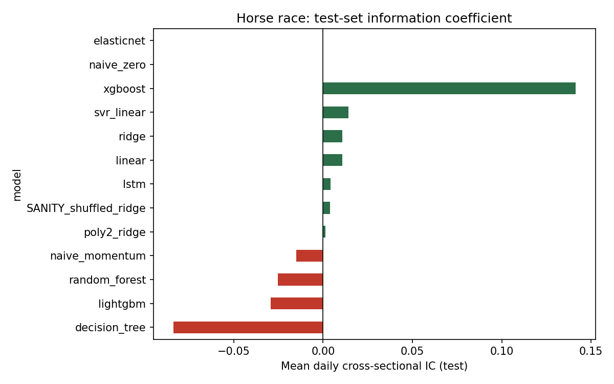
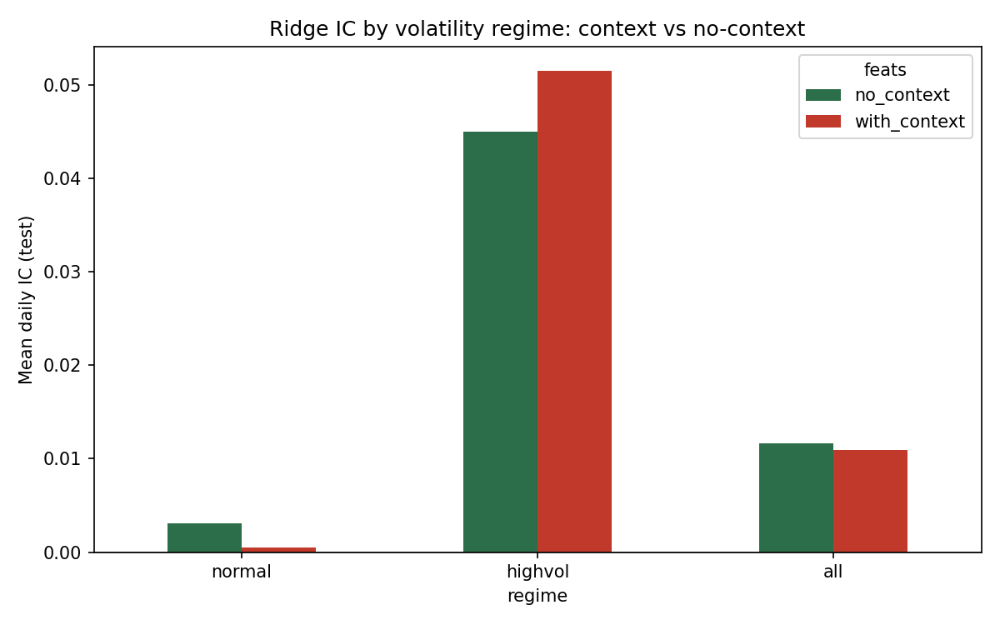
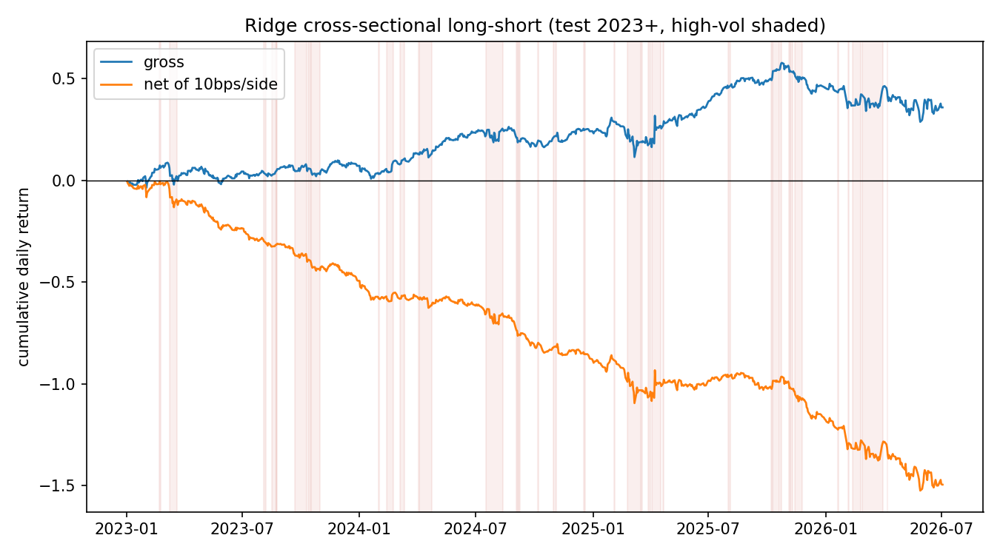

# LSTM vs Classical ML for Cross-Sectional Equity Return Prediction

Does an LSTM beat classical machine learning at forecasting daily US equity returns? On a panel of
518 S&P 500 constituents (March 2005 – July 2026, Bloomberg), under a strictly chronological
protocol with an explicit shuffled-target leakage control: **no model, LSTM included, predicts
next-day return levels better than a zero-return baseline.** Reframed cross-sectionally the
picture changes, but only in stress: a gradient-boosted tree reaches a mean daily rank IC of
0.044 (t = 3.2) on high-volatility days versus 0.005 (t = 0.9) on calm days, a decile long-short
earns a gross Sharpe of 2.09 in those periods, and **none of it survives transaction costs at
daily rebalancing** (net Sharpe negative in every configuration) while the signal decays to zero
IC at a five-day horizon. The detectable structure is real, short-horizon, stress-concentrated and
not exploitable at the frequencies studied. That is the conclusion, and the paper argues it is the
right one.

Nicholas Hong · NTU Undergraduate Research Opportunities Programme (UROP)

**Paper:** [`paper/LSTM_forecasting_IEEE.pdf`](paper/LSTM_forecasting_IEEE.pdf) · **Executed notebook:** [`notebooks/LSTM_stock_forecasting.ipynb`](notebooks/LSTM_stock_forecasting.ipynb) ([html](notebooks/LSTM_stock_forecasting.html))

---

## Results

**Level prediction (test set, 2023+, 466,426 stock-days).** No model materially beats naive zero
on RMSE: the largest improvement is 0.16% (XGBoost 0.020379 vs 0.020411). Cross-sectional IC of
the level forecasts:

| Model | Dir. acc. | IC | t |
|---|---|---|---|
| XGBoost | 0.497 | 0.141 | 1.83 |
| SVR (linear) | 0.490 | 0.014 | 2.42 |
| Ridge / Linear | 0.491 | 0.011 | 1.86 |
| LSTM (compact 32×1, early-stopped) | 0.480 | 0.004 | 0.76 |
| LightGBM | 0.496 | −0.029 | −0.69 |
| Shuffled-target ridge (leakage control) | 0.498 | 0.004 | 0.67 |



> **Which LSTM run is canonical.** `results/horse_race_results.csv` is the canonical horse race:
> the full 518-ticker Bloomberg panel, 466,426 test stock-days (465,904 for the LSTM after the
> 30-day sequence warm-up). Its LSTM row was produced by `run_all.py --quick`, i.e. the **compact**
> configuration `LSTM_CFG_QUICK` — 1 layer, hidden 32, dropout 0.1, early-stopped at 3 epochs on
> patience 2 (`results/lstm_training_curve.csv`).
>
> Two other LSTM runs exist in this repository and are **not** the reported result:
>
> | Artefact | Script | Configuration | Panel | Status |
> |---|---|---|---|---|
> | `results/horse_race_results.csv` | `run_all.py --quick` | 1×32, dropout 0.1, patience 2 | full, 465,904 test obs | **canonical** |
> | `results/ckpt/*.json` | `run_zoo_ckpt.py` / `run_lstm_ckpt.py` | 1×32, dropout 0.1, patience 2 | earlier, smaller panel — 269,831 test obs (269,309 LSTM) | superseded dev run, see `results/ckpt/README.md` |
> | `results/lstm_full_training_curve.csv` | `run_lstm_full.py` | **2×64, dropout 0.2, patience 5** (`C.LSTM_CFG`) | earlier panel | loss curve only — **test metrics were never persisted, so no result is claimed for this configuration** |
>
> The full-capacity 2×64 run reached a lower validation loss than the compact one (1.2557 vs 1.3970),
> so the compact model is not demonstrably the stronger of the two; re-running the full-capacity
> architecture on the canonical panel and persisting its metrics is an open item. It does not change
> the level-prediction conclusion: the LSTM loses to the naive-zero baseline on RMSE on **both**
> panels and under **both** configurations (0.021138 vs 0.020411 canonical; 0.020142 vs 0.019589 on
> the dev panel).

**Cross-sectional, regime-conditional (`results/xs_regime_results.csv`).** Target = each stock's
next-day return minus the equal-weighted universe mean; regime = VIX 63-day z-score > 1, frozen
before any test evaluation.

| Model | Regime | IC | t | L/S Sharpe gross | L/S Sharpe net (10 bp/side) | Turnover |
|---|---|---|---|---|---|---|
| LightGBM | high-vol (183 d) | **0.044** | **3.17** | **2.09** | −0.88 | 2.7 |
| LightGBM | normal (732 d) | 0.005 | 0.88 | −0.24 | −4.89 | 2.6 |
| Ridge | high-vol | 0.032 | 1.87 | 0.96 | −0.69 | 2.1 |
| Ridge | all | 0.015 | 2.76 | 0.48 | −1.99 | 2.0 |





At a weekly rebalance (`results/xs_weekly_results.csv`) the ridge IC is 0.0007: slower trading removes the
cost and the edge together. A four-factor regression of the daily long-short
(`results/risk_adjusted_results.csv`) leaves an insignificant alpha (t = 1.35 all days, 0.10 high-vol).

## Method

- **Data.** 518 S&P 500 constituents, OHLCV, exported from a Bloomberg Terminal with
  `mod_BBG_UROP_Export.bas` (not in this repo) into a long-format parquet; a yfinance mirror
  (`src/pull_yfinance.py`) emits the identical schema for development and was checked against the
  Bloomberg closes (`results/parity_report.csv`, median absolute difference ≈ 0). Context series:
  VIX, MOVE, DXY, the UST curve, commodities.
- **Protocol.** Chronological split only (train ≤ 2021, validation 2022, test 2023+). Features use
  information through the close of day t; target is the t → t+1 return. Scalers fit on train only.
  A shuffled-target ridge is run every time as a leakage alarm (|IC| must stay below 0.02).
- **Models.** Naive zero/momentum, linear, ridge, elastic-net, polynomial ridge, decision tree,
  random forest, XGBoost, LightGBM, linear SVR (`src/models_zoo.py`); a pooled-panel PyTorch LSTM
  with early stopping (`src/lstm_model.py`).
- **Evaluation.** RMSE, MAE, directional accuracy, daily cross-sectional rank IC with t-statistics;
  decile long-short with turnover and cost-adjusted Sharpe; regime split on a pre-registered
  threshold.

## Reproducing

```
pip install -r requirements.txt
python run_all.py --source yfinance           # dev mirror; --quick for a smoke run
python run_all.py --source bloomberg --skip-pull   # after dropping Bloomberg CSVs in data/raw/bloomberg/
python run_xs_regime.py                        # headline cross-sectional regime test
python run_xs_weekly.py                        # weekly-rebalance decay test
python regime_analysis.py                      # level-IC by regime
```

Runner scripts `run_lstm_ckpt.py` and `run_zoo_ckpt.py` are the resume-safe checkpointed variants;
their metrics land in `results/ckpt/*.json` and, for the zoo, in
`results/horse_race_results_ckpt.csv` — **not** in the canonical `results/horse_race_results.csv`
(see `results/ckpt/README.md`). `run_lstm_full.py` trains the full-capacity `C.LSTM_CFG`
architecture and writes only its loss curve. `docs/data_spec.md` describes the data files and their columns.

### Building the paper

Run from `paper/`:

```bash
mkdir -p build
printf '%s\n' '\AddToHook{class/IEEEtran/after}{\RequirePackage[OT1]{fontenc}}' \
  '\input{main.tex}' | tectonic -X compile - -o build
```

Tectonic is XeTeX-based and IEEEtran's Times (`ptm`) family is undefined under XeTeX's
default TU encoding, so without the `[OT1]{fontenc}` wrapper tectonic silently substitutes
Latin Modern and reflows the whole paper; the wrapper is what reproduces the Times
typesetting of the committed PDF. Because the source arrives on stdin the result is written
as `build/texput.pdf`. pdfTeX needs none of this — `pdflatex main.tex` builds the
source as-is.

## Repository layout

```
.
├── src/                      # library code: config, ingestion, features, models
├── run_all.py                # end-to-end runner: pull -> build -> train -> evaluate
├── run_zoo_ckpt.py           # checkpointed horse race, one model at a time (resume-safe)
├── run_lstm_ckpt.py          # checkpointed LSTM training, resumes from last epoch
├── run_lstm_full.py          # full-panel LSTM run (50-epoch cap, early stopping governs)
├── run_xs_regime.py          # headline cross-sectional regime test -> xs_regime_results.csv
├── run_xs_weekly.py          # 5-day-horizon weekly-rebalance decay test
├── run_regime.py             # level-IC by regime, context vs no-context
├── regime_analysis.py        # per-regime horse race (same output as run_regime.py)
├── compute_ls_series.py      # daily ridge long-short series -> ridge_ls_daily.csv
├── extract_xlsm.py           # one-off: Bloomberg workbook -> per-sheet CSVs
├── results/                  # committed metric CSVs, ckpt/*.json, figures/
├── paper/                    # IEEE manuscript (main.tex, PDF, class file, figure)
├── notebooks/                # executed notebook (.ipynb) + rendered .html
├── docs/                     # data spec
├── requirements.txt
├── LICENSE
└── README.md
```

## What is not here

The Bloomberg panel (licensed) and the per-stock prediction files (≈66 MB of parquet/CSV,
regenerated by the runners) are excluded. The `results/ckpt/*.json` metric files, the 117 KB LSTM
state dict, and every summary CSV the paper cites are committed. Two diagnostic plots from the
checkpoint runs (an empty weekly LightGBM curve, where the weekly run was degenerate, and a
two-point spread plot) were removed rather than published.

## Limitations

Current-member universe, so survivorship bias is present and documented; level targets in a
regime where nothing beats zero; costs modelled as a flat 10 bp per side; a single LSTM
architecture with four ablations rather than an architecture search. Research and educational use
only.

## Correction note (2026-08-23)

**The PDF in this repository (`paper/LSTM_forecasting_IEEE.pdf`) is now the corrected
typeset version**, rebuilt from `paper/main.tex`. Table II of that PDF prints the
LightGBM net-Sharpe column correctly.

The originally typeset PDF had three cells in that column transcribed from the wrong
columns of the source CSV:

| Row | Originally typeset | Correct, and now in the PDF (`results/xs_regime_results.csv`) |
|---|---|---|
| LightGBM, high-vol | −0.24 | **−0.88** |
| LightGBM, normal | −1.91 | **−4.89** |
| LightGBM, all | −2.02 | **−3.55** |

The Ridge rows and every other column of Table II were correct throughout, and no
other part of the paper changed.

`results/xs_regime_results.csv` and the executed notebook were always the authority
for every number in this project; they were never wrong, and the Results table above
has always shown the correct values. The paper's conclusion is unaffected: every net
Sharpe is negative under both the originally printed and the corrected numbers, so
costs still eliminate the edge in every configuration.
